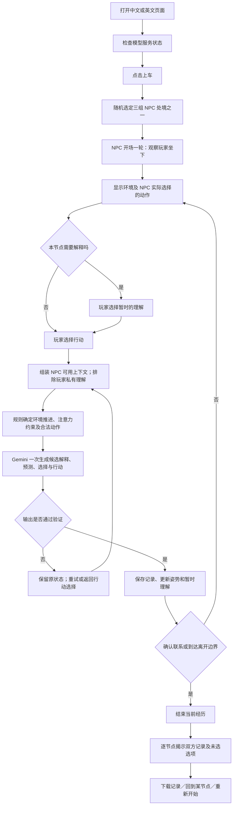

# 《同车》0.4：完整 Pipeline 与 Workflow 报告

核对日期：2026-10-24。依据当前本地源代码与本次会话中的发布记录整理。本文描述实际实现；设计目标、已经实现的约束和仍存在的缺口分别注明。此次只整理报告，没有修改游戏或重新发布。

## 1. 当前游戏究竟是什么

《同车》是一个中文／英文纯文字短篇原型：玩家在夜班公交上与一个陌生人相邻而坐，通过观察、解释和细小行动经历一段尚未确认的关系。双方确认某次交流确实指向彼此时结束；也允许没有搭上线就各自离开。

核心体验是：我只能看到动作，不能直接看到对方的原因；我的解释影响我的行动，行动又成为对方解释我的材料。结束时，玩家回看双方在当时分别看到了什么、猜了什么、采取了什么行动。

**实际架构：预设事件骨架 + 有限动作菜单 + Gemini 的角色决策 + 浏览器中的状态与复盘。**

当前不是完全由模型自由展开的剧情。车辆运行、小票滑落等事件预写；玩家选项预写；NPC 可执行动作及对应的可见文字也预写。Gemini 生成解释、预测和简短依据，选择一个合法动作。

## 2. 总流程图

模型服务不可用时，入口明确显示离线规则试玩，使用同一套世界规则与界面，不调用 Gemini。

## 3. 四部分分工

| 部分 | 实际负责什么 | 主要文件 |
|---|---|---|
| 玩家界面 | 开始、两阶段选择、等待、错误处理、结局、复盘、下载、重走 | `prototype/dist/app.js` |
| 游戏规则 | 初始事实、节点、选项、合法动作、状态转换、终点、记录结构 | `prototype/dist/game.js` |
| Gemini 服务 | 构造请求、约束输出格式、调用模型、验证结果、保护密钥 | 本地 `prototype/server.py`；线上 `prototype/worker/gateway.js` |
| 构建与发布 | 生成英文文件、打包线上 Worker、同步源码、保存版本并部署 | `prototype/build_languages.py`；`prototype/scripts/build_hosted.py`；Sites 发布工具 |

游戏的权威状态目前在浏览器内。服务端是模型代理与部分规则验证器，没有数据库或服务器会话来独立重建一整局。

## 4. 开局 Pipeline

### 4.1 检查服务

页面载入后请求 `GET /api/status`。

- `ready=true`：进入 Gemini 模式。
- 未连接、接口不可达、状态不可用：进入明确标注的离线模式。
- 当前检查中的 `ready` 主要表示服务已配置密钥，**不会先进行一次模型调用来验证密钥、额度或实际可用性**。
- 模式在本次页面载入时确定；没有后台持续重新检查和自动切换。

### 4.2 固定 NPC 的个人处境

点击上车后，从三组处境中随机选一组，整个本局保留：

| 组别 | 个人目标 | 身体／环境处境 | 手机内容 | 规则中的最晚离开边界 |
|---|---|---|---|---|
| A | 第三站下车，取修好的眼镜 | 雨湿的袖口贴着皮肤 | 维修店的取件提醒 | 完成第 6 个玩家节点后 |
| B | 到终点，确认换乘位置 | 久坐右腿发麻 | 换乘地图 | 第 8 个节点边界 |
| C | 到终点回家 | 窗缝有冷风 | 家人的普通消息 | 第 8 个节点边界 |

这些信息在系统中开局即存在，NPC 每轮都能收到。正常游玩时不直接告诉玩家。

`seed` 当前只用于选这三组设定之一；不控制 Gemini 的随机采样，因此同一组设定不保证同样的模型回应。

### 4.3 NPC 先完成开场一轮

游戏将“玩家坐到过道边，把包放上膝盖”作为 NPC 可观察的开场动作，发送第一次模型请求。

模型选出自己的开场动作后，玩家才看到第一节点的完整画面。开场记录单独保存，结束时单独揭示。

## 5. 玩家一轮怎样运行

### 5.1 看到什么

每一轮显示：

1. 玩家刚才做的动作（第一轮没有）。
2. 当前节点的环境文字。
3. NPC 上一轮实际选中的动作。
4. 当前可选的理解或行动。

NPC 动作不会被一个新的预写人物动作覆盖。环境事件仍由节点骨架推进。

### 5.2 先理解，再行动

除“刹车”和“到站”外，各节点先提供四个暂时理解，包括“现在还判断不出”。理解菜单根据 NPC 上一个动作类别切换：例如换位、让路、看向玩家，会出现不同解释。

玩家选定理解后，进入行动菜单。此时可以返回换一种理解。

**解释不会改变行动菜单，也不会被放入 NPC 请求。**

因此，代码中的因果关系是：

> 玩家看到事件 → 玩家在心里形成理解 → 玩家自己据此决定动作 → 系统只把动作传给 NPC。

如果只改变理解选项、实际行动完全相同，NPC 收到的上下文相同。真实模型可能因采样给出不同输出，但不是因为它读取了那个私有理解。

### 5.3 当前八个节点

| 顺序 | 固定环境事件 | 玩家行动菜单概述 | 是否先选理解 |
|---|---|---|---|
| 1 坐下 | 上车坐在陌生人旁边 | 收包／挪脚／看窗外 | 是 |
| 2 倒影 | 车离站，窗上倒映两人 | 抱包／侧身让过道／看路线图 | 是 |
| 3 刹车 | 车猛地一刹 | 抓自己座椅／收包／坐稳看窗外 | 否 |
| 4 下一站 | 车停又开，过道空着 | 收腿继续坐／抱包起身／询问是否要过去 | 是 |
| 5 脚边 | NPC 小票落到玩家脚边 | 递还／指给他看／移脚不处理 | 是 |
| 6 站名 | 车内报站 | 放稳包／点头／看窗外／询问是否东门 | 是 |
| 7 空出的地方 | 东门站过去，出现空座位 | 换座位／原地看窗外／询问刚才是否在让自己 | 是 |
| 8 到站 | 玩家目的地到了 | 下车／向 NPC 道谢 | 否 |

这是最多八个节点的顺序骨架，分支主要来自人物行为、解释、提前联系和离开边界，尚不存在大量可自由重排的环境事件。

## 6. NPC 一轮的输入

玩家提交动作后，浏览器先组装 NPC 上下文，再发送 `POST /api/react`。

| 输入 | 用途 |
|---|---|
| 当前节点、开场或回应阶段、下一节点 | 明确这轮发生在什么时候 |
| 自己固定的个人处境 | 提供独立于玩家的目的、身体状态和手机背景 |
| 双方当前坐／站／换位状态 | 限制可执行动作 |
| 玩家本次可观察动作及文字 | 本轮解释的直接材料 |
| NPC 自己上一轮动作 | 保持自身行为连续性 |
| 上次采用的解释类别 | 延续暂时理解 |
| 上次选定的解释、预测及动作 | 提供短期决策记忆 |
| 之前确实注意到的玩家行为和对应理解 | 提供观察历史 |
| 本轮环境、物品归属和先后顺序提示 | 避免人物、物品、时间关系混淆 |
| 必须注意的标志、离开边界 | 规则约束 |
| 英文模式语言标志 | 要求新生成的选项与依据使用英文 |

明确排除：玩家选的内心理解、尚未提交的未来行动、玩家的四站目的地提示、完整玩家心理记录。

这里的隔离主要针对正常游戏请求。NPC 并非拥有视觉传感器；注意力、距离与动作都是文字状态。

## 7. NPC 怎样注意、理解、预测和行动

### 7.1 注意力规则

以下情况强制 `noticed=true`：开场、明确指向对方的交流、大多数明显动作，以及上一轮没有注意到玩家后的这一轮。

只有以下动作允许“不注意到”：看窗外 `window`、不处理小票 `ignore`、抓自己的座椅稳住 `steady`；上一轮若已经忽略玩家，这一轮仍必须注意。

“必须注意”只保证记录为注意到，不保证理解正确，也不保证接近或回答。明确交流时仍可选择 `miss`，表示没有回应；由于该轮强制注意，当前的 `miss` 并不严格等同于没有听见。

没有注意时，选中的解释类别必须沿用此前类别。代码检查的是类别不变；具体文字是否完全没有偷偷利用新信息，仍依赖提示词与模型表现。

### 7.2 规则先给出合法动作菜单

候选解释、候选预测由 Gemini 生成；候选动作由规则给出。

| 场合 | 可用动作范围 |
|---|---|
| 普通回合 | 看玩家、让过道、扣手机、看站名、停留、调整坐姿等 |
| 当前站着 | 可以坐回去 |
| 中后段且未站起 | 可以起身让出座位前的空间 |
| 已有其他空座位且未换过去 | 可以换到另一边 |
| 下一节点刹车 | 只在抓扶手／按座椅边之间选 |
| 下一节点小票落下 | 增加看到小票暂不捡的选择 |
| 玩家不处理小票 | 强制自己捡起小票 |
| 玩家明确交流 | 只在确认回应／没有回应之间选 |
| 必须离开 | 对应的离开动作，通常只剩一个选项 |

因此并非每轮都有同等不确定性。强制事件可能只有一个合法结果。重复动作的硬限制也很少，例如禁止连续选择看手机，未全面禁止连续看人、停留或让路。

### 7.3 一次 Gemini 请求返回完整决策记录

当前模型是 `gemini-2.5-flash`。生成参数：温度 0.95，最多 1800 输出 token，`thinkingBudget=0`，JSON 结构化输出。

返回内容：

1. 是否注意到玩家。
2. 三个候选解释，每个含文字与类别：未知、需要空间、准备离开、试图联系、处理自己的事。
3. 实际选定的解释 ID。
4. 三个对玩家下一步行为的预测，每个含文字与类别：保持、调整、发起交流、离开。
5. 实际选定的预测 ID。
6. 从合法动作菜单中选出的动作 ID。
7. 一句连接解释、预测和行动的简短依据。

**这是一轮一次请求。**“先解释、再预测、再行动”目前是提示词与返回结构表达的逻辑顺序，没有拆成三次独立调用。系统没有单独验证某个解释一定导致了所选动作，也没有计算候选概率或优化收益。

“候选解释”是作为游戏内容生成的角色判断；不是模型隐藏推理的完整转录。提高温度增加变化，但不保证选项实质不同或故事更有趣。

### 7.4 输出验证与执行

验证包括：结构、三项菜单、ID 唯一、选中项确实存在、类别合法、动作属于本轮菜单、注意力规则及文字长度上限。

验证通过后：

- 观察记录直接引用玩家的实际动作，模型不自由改写“看到了什么”。
- 选中的动作 ID 映射为预写短句。NPC 可见行为文字与交流短句不是 Gemini 自由生成。
- 更新 NPC 的坐站位置和暂时理解类别。
- 保存这一轮的全部候选、选择、依据及玩家动作。
- 若继续，选中的 NPC 动作直接成为玩家下一轮看到的动作。

## 8. 一个完整交错回合的例子

以下是说明机制的例子，不保证每局出现相同输出：

1. NPC 看见玩家坐下，暂时理解为只是找座位，预计玩家会安静坐着，选择保持不动。
2. 玩家看到他没动，选“现在还判断不出”，然后收紧包。
3. NPC 收到的是“玩家收紧包”，不会收到玩家那句内心理解。
4. NPC 提出三个解释：玩家想坐舒服点／嫌两人挤／准备离开，并选其中一个。
5. NPC 预测玩家接下来会调整位置，选择往窗边挪。
6. 玩家下一轮看到的就是“他往窗边让了一点”。玩家可能把它解释为排斥，也可能认为是在体谅自己。
7. 玩家因此换位或询问，成为 NPC 下一轮的新材料。
8. 结束后，玩家看到 NPC 其实选了哪种解释，以及自己的行动是否符合对方预测。

主题依赖这种“彼此根据不完整证据行动”的循环，而非结尾给玩家一个正确答案。

## 9. 什么时候结束

### 9.1 确认联系

玩家明确向 NPC 提问、递还物品、指示物品、点头或道谢；NPC 注意到并选择 `acknowledge`，立即结束。

单纯调整包或姿势不触发确认。当前可见动作集合也不允许 NPC 在普通回合自主发起一句问话。

### 9.2 各自离开

玩家选择下车，或 NPC 达到自身离开边界且未确认联系，结束为各自离开。

确认联系和没有联系都没有胜负、善恶或亲密度评分。

### 9.3 当前终点实现存在的边缘问题

- 第八节点若玩家道谢、NPC 选择不回应，后续通用离开兜底会写成 NPC 在东门下车。这与该节点“玩家的站到了”不一致。
- 东门是否已经经过、该节点提问的“这站是东门吗”与固定回答之间，仍有需要统一的时序细节。

这些是现有实现的缺口，本文记录但未修改。

## 10. 结尾复盘与存档

### 10.1 过程中保存什么

开场单独保存。每个玩家节点保存：节点与环境、当时看到的 NPC 动作、玩家理解与动作、NPC 前后两轮记录、此前预测与玩家实际后续动作、额外离开结果。

每份 NPC 决策包含：是否注意、观察记录、三个解释及选择、三个预测及选择、合法行动菜单及选择、可见行动、简短依据、是否确认联系、下一理解类别、来源为 Gemini 还是离线。

### 10.2 界面如何揭示

先显示开场，再按节点并排展示“你这边”和“接下来他的完整一轮”。候选解释、候选预测和动作菜单可以展开，勾选实际选择。

预测下方展示玩家随后真正做的动作。故事若结束，标明该预测尚未被检验。没有自动准确率评分或“你是怎样的人”的评价。

**目前复盘页面没有单独展开 NPC 的完整初始个人处境。**它们可能出现在模型依据中，但完整设定只在下载文件的 `initialNpcFacts` 中提供。因此“揭示所有背景信息”尚未完全做到。

### 10.3 下载、回到旧节点、刷新

- 下载：JSON 文件，包含版本、模式、设定种子、初始 NPC 事实、结局、开场和节点记录。
- 回到某节点：恢复该节点玩家行动前的内存快照，保留此前设定和记录，重做后续。
- 重新走会再次请求 Gemini；即使行动相同也可能得到不同结果。
- 原来分支的后续记录不会作为一个可对照分支永久保存；需要先下载才方便保留。
- 页面刷新、切换语言或重新开始会清空本局。没有自动本地存储、跨设备存档或云端用户档案。

## 11. 模型请求失败时怎么办

网页等待上限为 45 秒；本地模型网络请求使用 35 秒超时，线上也设为 35 秒。

请求失败、限流或输出不合法时，不写入该轮记录、不推进节点、不自动换成离线结果。玩家可以重试，或回到动作选择；开场失败只能重试开场。

重试是一次新的生成，可能改变模型结果。网页在请求期间显示等待画面，避免普通流程中的重复提交。重开与重走使用版本标记，忽略不属于当前局面的迟到结果，但不保证已发出的远程请求会停止计算或取消计费。

## 12. 本地与线上的运行 Pipeline

### 12.1 本地

浏览器 → `127.0.0.1:8766` 的 Python 服务 → Gemini → Python 验证 → 浏览器规则执行与记录。

`server.py` 提供静态文件和两个 API。密钥通过隐藏输入或环境变量进入服务内存，不发给网页。本机同时只允许一个模型请求；第二个请求返回繁忙提示。服务只监听本机地址。

本地服务停止后地址不可用，重新运行服务即可恢复，游戏文件不会随服务停止而丢失。

### 12.2 线上

浏览器 → Sites 托管的 Cloudflare Worker → Gemini → Worker 验证 → 浏览器规则执行与记录。

Worker 同时提供中英文静态页面和 API。密钥配置为托管服务端秘密。请求进行同源检查，并有按来源地址、每小时 60 次的进程内限流；该限流会受实例分散或重启影响，不能视为严格的账户费用上限。

没有数据库，也没有把每一局结果保存到服务器。模型请求的上下文会发送给 Gemini 服务。

### 12.3 三种模式的区别

| 模式 | NPC 决策来源 | 运行依赖 | 注意 |
|---|---|---|---|
| 本地 Gemini | 真实模型 | 本机服务、网络、有效凭据和额度 | 服务需持续运行 |
| 线上 Gemini | 真实模型 | 托管后端、Gemini 可用 | 不依赖玩家电脑上的服务 |
| 离线规则 | 代码中的确定性规则 | 静态网页即可 | 当前总会记录注意到玩家，不能代表真实模型表现 |

## 13. 中英文工作流

中文 `game.js`、`app.js`、`index.html` 为共享规则与界面源文件。运行 `build_languages.py`，结合两份翻译表生成 `game.en.js`、`app.en.js`、`en.html`。

英文请求增加 `language=en`，服务端要求模型的候选解释、预测与依据用英文。切换语言会开始新的一局，不转换当前存档。

翻译构建会检查英文文件中是否遗留中文（语言切换链接除外）；一致性测试比较中英文规则转换、动作 ID 与结局。

## 14. 开发、验证、发布 Workflow

1. 修改中文规则／UI或后端。世界规则主要在 `game.js`；本地后端还维护一份合法动作逻辑，修改时须同步。
2. 涉及新文字时更新翻译表，运行 `python3 prototype/build_languages.py`。
3. 执行规则和语言一致性检查：`node prototype/test.cjs`、`node prototype/test_languages.cjs`。
4. 本地启动 `server.py`，用真实 Gemini 检查角色判断、事件连贯、提前结束与复盘。
5. 执行 `prototype/scripts/build_hosted.py`。它读取 Python 后端中的提示词、JSON 格式和动作说明，嵌入中英文静态文件、共享规则及 Worker 网关，生成 `dist/server/index.js`。
6. 使用 Sites 源码工作流提交并推送准确源码，打包同一份代码对应的部署归档。
7. 保存版本，部署该版本，确认部署成功及返回网址。发布还会采用当时的服务端秘密配置版本。
8. 检查线上入口与真实模型请求。需要时同步文档中的版本、网址和验证范围。

**本地修改不会自动同步线上。**修改前端、翻译或后端之后，都需要重新构建发布包并发布；只在本地刷新看不到旧线上部署的变化。

目前已运行的规则测试覆盖 86 个归并后的状态、774 次选择；语言一致性检查覆盖 252 次转换。这些检查主要使用离线决策来验证规则，并非穷尽所有 Gemini 输出。此前已进行中文真实模型至结局与复盘检查，以及线上开场和玩家行动后回应检查；不是所有人物设定和模型分支都被人工穷尽验证。

## 15. 设计目标与实际实现的差异

| 目标 | 当前已做到 | 当前边界或缺口 |
|---|---|---|
| 双方根据有限信息理解彼此 | 玩家理解不进入 NPC 请求，NPC 保留暂时判断 | 隐藏状态在浏览器内，技术上可查看；不是服务器保密 |
| 理解改变经历 | 玩家解释经由玩家实际动作间接影响后续 | 没有把玩家解释自动转换为姿势、注意或世界变化 |
| NPC 完整交错回合 | 开场及每次行动后生成解释、预测、行动；下一轮直接显示动作 | 一次请求生成，未做阶段间独立因果校验 |
| NPC 更注意玩家 | 明显动作强制注意，避免连续忽略 | 即使“不注意”，请求仍包含当前动作，由提示词限制使用；不是输入层真正遮蔽 |
| 行动拥有独立原因 | 固定个人处境、固定环境进入模型上下文 | 没有逐动作的“外因／个人原因／回应玩家”结构化因果标签 |
| 非固定发展 | 模型可以选择不同解释、预测和行动 | 八个环境节点及玩家菜单仍固定 |
| 回应鲜明不同 | 姿势、目光、让路、换位、交流或离开不同 | 部分选项不改变后续玩家菜单，实际后果差异有限 |
| 姿势与空间连续 | 记录坐／站／跨过道换位 | 后续仍可能出现不适合位置的预写动作，例如换位后又往原窗边挪 |
| 结尾帮助重新理解 | 揭示当轮候选和选择，并对照玩家后续动作 | 未完整展示初始背景；不是客观动机认证 |
| 人物理解会随经历改变 | 先前解释与观察历史影响后续模型输入 | 没有模型训练、长期学习或跨局人格成长 |
| 完整结束 | 联系与离开两种终点 | 最末节点未回应后的兜底离开叙述有冲突 |
| 稳定安全地运行公开原型 | 密钥在服务端，合法动作与格式验证，同源检查和基本限流 | 状态由客户端提供，未实现严格服务端会话校验；不适合声称生产级防篡改或费用控制 |

## 16. 最关键的实现判断

目前真正运作的循环是：

> **固定环境 + 双方历史 → 玩家解释与行动 → 模型根据文字上下文生成角色选择 → 规则执行有限行动 → 玩家重新解释 → 结尾对照两份当时记录。**

它最接近一个“受规则约束的、相互解释的短篇关系模拟”。叙事自由度、空间状态、事实因果和复盘完整度，仍有明确的原型边界。

## 17. 文件与入口

- 规则：`prototype/dist/game.js`
- UI：`prototype/dist/app.js`、`prototype/dist/index.html`
- 本地代理及提示词：`prototype/server.py`
- 线上代理：`prototype/worker/gateway.js`
- 线上构建：`prototype/scripts/build_hosted.py`
- 语言生成：`prototype/build_languages.py`
- 翻译表：`prototype/i18n/en.json`、`prototype/i18n/ui.en.json`
- 检查：`prototype/test.cjs`、`prototype/test_languages.cjs`
- 托管身份：`prototype/.openai/hosting.json`（不含密钥）
- 设计总文档：`游戏设计_合并版.md`

本地中文：http://127.0.0.1:8766/index.html?v=4

本地英文：http://127.0.0.1:8766/en.html?v=4

线上中文：https://along-the-way-jam-1023.fitcat.chatgpt.site/

线上英文：https://along-the-way-jam-1023.fitcat.chatgpt.site/en.html
